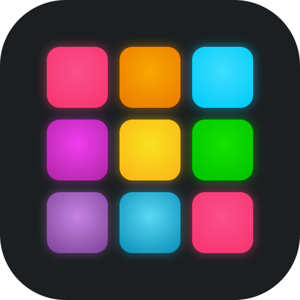
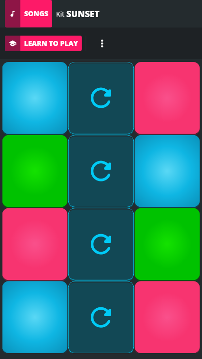
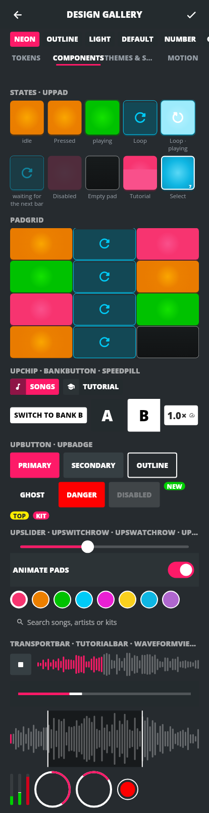

<p align="center">
  
</p>

<h1 align="center">UltraPads</h1>

<p align="center">
  <a href="LICENSE"></a>
  <a href="https://github.com/PlutoKeating/Project.UltraPads/releases"></a>
  
  
</p>

UltraPads 是一款打击垫（launchpad）与音乐创作软件，用 Flutter 写界面、Rust 写实时音频引擎，一份代码打包到多个平台。

项目以学习研究为目的，目标是一个既能随手玩、也能承载复杂编曲的工具：

- 引擎和界面完全解耦；
- 曲库使用开放格式；
- 支持个人多设备在局域网内协同。

<p align="center">
  
  &nbsp;
  
</p>

## 功能

- **演奏**：一首歌可以有一组或多组音色（A、B、C… 最多 7 组），每组 12 个 pad，演奏中一键切换组，已经在播放的声音不会中断。
  - 触摸到即发声：按下或手指滑进 pad 都立即触发，支持多点触控；每个 pad 可设为 One-shot、Loop 或 Gate。
  - 支持 choke 组和按小节量化启动，每个 pad 可单独变调（±12 半音）。
  - Linux 走 PipeWire 原生音频通路 + 实时优先级（指令到发声约 4 ms），Android 走 AAudio 低延迟模式。
- **曲库**：
  - Kit 格式为 `.upkit`，即 SFZ 加 JSON 旁挂文件，用 BLAKE3 做内容寻址。
  - 可导入 SFZ、WAV 文件夹，也有私有素材包导入器。
  - 项目可导出为 DAWproject。
- **编辑 Kit**：新增、删除、调整音色组顺序，给 pad 换音色（内置、麦克风、本地文件、其他 Kit、录音），调整 pad 属性，裁剪和试听样本。
- **录音与作品**：录下主输出生成作品，作品卡带波形，可循环播放、导出 WAV 和分享。
- **官方曲库**：应用内浏览、搜索、筛选并按需下载大量现成曲目（原创 CC0 合成曲、AlbumDB、ccMixter 等），每首都是按乐器分音色组、按小节切好循环的 Kit，开箱即可即兴重排；逐条标注许可证与署名。登录 PlutoKeating 账号后云端同步收藏、最近使用与下载记录。
- **皮肤**：3 套主题（霓虹、描边、浅色）、16 套内置皮肤预设，另有自定义皮肤编辑器。
- **个人多设备协同（Hub）**：
  - 设备在局域网内通过 mDNS 自动发现，用 6 位配对码配对，配对过程基于 SPAKE2 加双向 TLS。
  - 曲库在设备间增量同步。
  - 手机可以当作电脑的实时打击垫控制器。
  - 不依赖任何公共服务器。
- **国际化**：中文和英文。文案集中在独立的 i18n 包里，页面中不硬编码任何语言。
- **设计系统**：
  - 设计 token 按 W3C DTCG 格式编写，生成 Dart 和 CSS 代码。
  - 应用内有组件画廊（Design Gallery）。
  - 用 lint 保证全仓库不硬编码颜色或外形值。
- **无头 CLI**：`up-cli` 支持离线渲染、单 pad 播放、延迟探针和 WAV 检查。
- **安装与更新**：Linux 一行命令安装（免 sudo），应用内检查并安装新版本（Linux 就地更新并重启，Android 交给系统安装器）。

全部需求见 [`docs/REQUIREMENTS.md`](docs/REQUIREMENTS.md)，版本记录见 [`CHANGELOG.md`](CHANGELOG.md)。

## 下载与安装

官网：<https://ultrapads.plutokeating.beer>

**Linux（x86_64 / arm64）**，在终端运行（不需要 sudo，再运行一次就是更新）：

```bash
curl -fsSL https://ultrapads.plutokeating.beer/install | bash
```

- 安装到 `~/.local/opt/ultrapads`，命令为 `~/.local/bin/ultrapads`，并写入桌面项和图标。
- 支持 Debian 12+、Ubuntu 23.04+、Fedora 38+、Arch 等（需要 glibc ≥ 2.36、PipeWire ≥ 0.3.65 的库；Ubuntu 22.04 不支持）。
  需要 GTK 3、ALSA、PipeWire 与 D-Bus 运行库，缺少时脚本会询问后用系统包管理器安装（`--yes` 跳过询问）。
- 选项写在 `bash -s --` 之后：`--version 0.1.0`（安装指定版本）、`--prefix <目录>`、`--no-desktop`、`--no-modify-path`、`--uninstall`（保留曲库与设置）。
- 应用启动后会检查新版本（设置 → 关于 → 软件更新，可关闭），点「更新」即在应用内完成更新并重启。

**Android 8.0+**：在官网或 [Releases](https://github.com/PlutoKeating/Project.UltraPads/releases) 下载 APK，大多数手机选 `arm64-v8a`（另有 `armeabi-v7a`、`x86_64`）。之后的新版本可以在应用内下载并交给系统安装器。

| 平台 | 文件 |
|---|---|
| Linux x64 / arm64 | `ultrapads-<版本>-linux-x64.tar.gz` / `…-linux-arm64.tar.gz`（安装脚本使用的包，也可手动解压运行 `./ultrapads`，但这样不能应用内更新） |
| Android | `ultrapads-<版本>-android-<abi>.apk` |
| 校验 | `SHA256SUMS.txt` |
| 无头 CLI | `ghcr.io/plutokeating/ultrapads-cli`（容器镜像，见下文） |

## 从源码构建

需要 Flutter 3.47、Rust stable、just、pnpm；构建 Android 还需要 NDK 28.2 和 cargo-ndk。完整的版本要求见 [`docs/QUICK_START.md`](docs/QUICK_START.md)。

```bash
git clone https://github.com/PlutoKeating/Project.UltraPads.git
cd Project.UltraPads
just bootstrap      # 拉取 Dart、Node、Rust 依赖
just run-linux      # 运行 Linux 版（真实引擎）
just run-mock       # 不编译 Rust，用 Mock 引擎运行界面
```

常用命令（`just --list` 可查看全部）：

| 命令 | 作用 |
|---|---|
| `just check` | Rust 和 Dart 全量检查：fmt、clippy、测试、analyze、硬编码 lint、i18n 检查 |
| `just build-linux` | 构建 Linux release |
| `just build-android` | 构建 Android release APK（按 ABI 拆分） |
| `just tokens` / `just codegen` | 重新生成设计 token 和 Rust↔Dart 绑定 |
| `just icons` | 由 `design/brand/ultrapads-mark.svg` 重新生成全平台应用图标与官网图标 |
| `just bump <X.Y.Z>` / `just release` | 统一修改版本号 / 打 tag 推送，由 GitHub Actions 构建并发布（见 QUICK_START「发布」） |
| `just package-linux` / `just website-test` | 本地打 Linux 发布包 / 运行官网与安装脚本测试 |
| `just cli <参数>` | 运行无头 CLI |
| `just inject-assets` | 可选：把本机自备的私有素材包注入应用（不入库） |

### 无头 CLI 容器

```bash
docker run --rm ghcr.io/plutokeating/ultrapads-cli:0.0.1 --help
# 离线渲染：音频文件夹（按文件名依次对应 pad A0..B11）+ 事件脚本 → WAV
docker run --rm -v "$PWD:/work" -w /work ghcr.io/plutokeating/ultrapads-cli:0.0.1 \
  render --kit-dir samples/ --events events.json --out out.wav
```

## 架构

```
┌─────────────────────────────────────────────┐
│ ③ 前端  app/ultrapads + packages/up_*      │  Flutter：页面、组件、主题、动效、i18n
│         只发 Command、订阅 Event/快照      │
├──────────────── bridge/up-ffi ──────────────┤  flutter_rust_bridge，Dart 的唯一入口
│ ② 运行基座  runtime/                        │  up-host 音频设备与存储 · up-library 曲库
│                                             │  up-hub 多设备协同 · up-update 应用内更新
│                                             │  up-cli 无头工具
├─────────────────────────────────────────────┤
│ ① 纯引擎  engine/                           │  音频图、采样器、传输、混音、录音、
│         零平台依赖、音频线程零分配零锁      │  数据模型、文件格式、协议
└─────────────────────────────────────────────┘
```

- 引擎是业务状态的唯一事实源，界面只持有只读投影。
- 按 pad 时，Flutter 的原始指针事件通过同步 FFI 直接写入 Rust 的无锁队列。
- 音频后端用 cpal：Linux 上优先走 PipeWire 原生通路（经 rtkit 提为实时优先级，没有 PipeWire 时回退 ALSA），Android 上走 AAudio 低延迟模式。音频图基于 Firewheel，外面包了一层自研抽象。

详见 [`docs/ARCHITECTURE.md`](docs/ARCHITECTURE.md)。

## 仓库结构

```
engine/        ① 纯引擎（Rust crates：core、dsp、graph、sampler、transport、mixer、recorder、model、format…）
runtime/       ② 运行基座：up-host、up-library、up-hub、up-update、up-cli
bridge/up-ffi  Rust ↔ Dart 的 FFI 接口
app/ultrapads  ③ Flutter 应用
packages/      up_tokens（设计 token）up_ui（组件）up_fx（光效）up_i18n（多语言）up_engine（引擎客户端契约）
design/tokens  W3C DTCG token 源 + Style Dictionary 构建
design/brand   品牌标志（UP 组合字）与应用图标 SVG
content/       Kit schema 与 CC0 示例 Kit
tools/         lint、素材注入、图标生成、发布脚本、catalog（官方曲库素材入库管线）
website/       官网 ultrapads.plutokeating.beer：安装脚本、下载页、发布接口与镜像、官方曲库目录与账号数据接口（Cloudflare Worker）
data/          ultrapads-data：官方曲库目录与账号数据服务（Node + SQLite，Docker）
docs/          架构、API、需求、ADR、调研
```

## 文档

| 文档 | 内容 |
|---|---|
| [`docs/QUICK_START.md`](docs/QUICK_START.md) | 环境准备、构建运行、Android 模拟器、Hub 联调、发布 |
| [`docs/ARCHITECTURE.md`](docs/ARCHITECTURE.md) | 分层、线程模型、平台适配、设计系统、多设备协同 |
| [`docs/API.md`](docs/API.md) | 引擎协议、FFI 接口、Hub 协议、发布与更新接口 |
| [`docs/REQUIREMENTS.md`](docs/REQUIREMENTS.md) | 功能和非功能需求 |
| [`docs/adr/`](docs/adr/) | 架构决策记录（含 ADR-0005 官方曲库与账号） |
| [`docs/research/`](docs/research/) | 格式调研、v0.0.1 验证记录 |

## 参与贡献

欢迎提 Issue 和 Pull Request。提交前请运行 `just check` 并确保全部通过；涉及界面的改动不得硬编码颜色、尺寸或文案，应复用 `up_tokens` / `up_i18n`。

## 许可证与声明

代码以 [Apache-2.0](LICENSE) 许可发布。可选的 GPL 组件（如 Ableton Link）默认关闭。

本项目只用于学习和研究；仓库不包含、也不分发任何第三方私有素材。
